  

  <b>MAGIC SOFTWARE &amp; SOLUTIONS (PVT) LTD</b> · Islamabad, Pakistan 
  🌐 <a href="https://www.magicsolutions.tech">magicsolutions.tech</a> &nbsp;·&nbsp; ✉️ <a href="mailto:hello@magicsolutions.tech">hello@magicsolutions.tech</a>

## ✨ Who we are

We are a software company that turns ideas into working software. We build the systems businesses run on, and add AI where it earns its place:
custom software, AI agents with guardrails, language-model fine-tuning and RAG, ERP and point-of-sale systems, fast 3D websites and
applications designed around the people who use them.

> *Exceptional software takes time. We start by understanding the problem, then deliver working software in milestones you can see.*

## 🔮 What we build

## 📊 Our GitHub at a glance

## ⚡ Recent activity

## 📦 Latest repositories

<!--REPOS:start-->
- Our public repositories will be listed here as soon as we open-source something.
<!--REPOS:end-->

## 🤝 Let's build something

Tell us what you want to build and we will tell you how.

- 🌐 Website and services: [magicsolutions.tech](https://www.magicsolutions.tech)
- ✉️ Email: [hello@magicsolutions.tech](mailto:hello@magicsolutions.tech)
- 🧑‍💻 Careers: [magicsolutions.tech/careers](https://www.magicsolutions.tech/careers)

The stats and activity above refresh automatically every few hours from public GitHub data.

